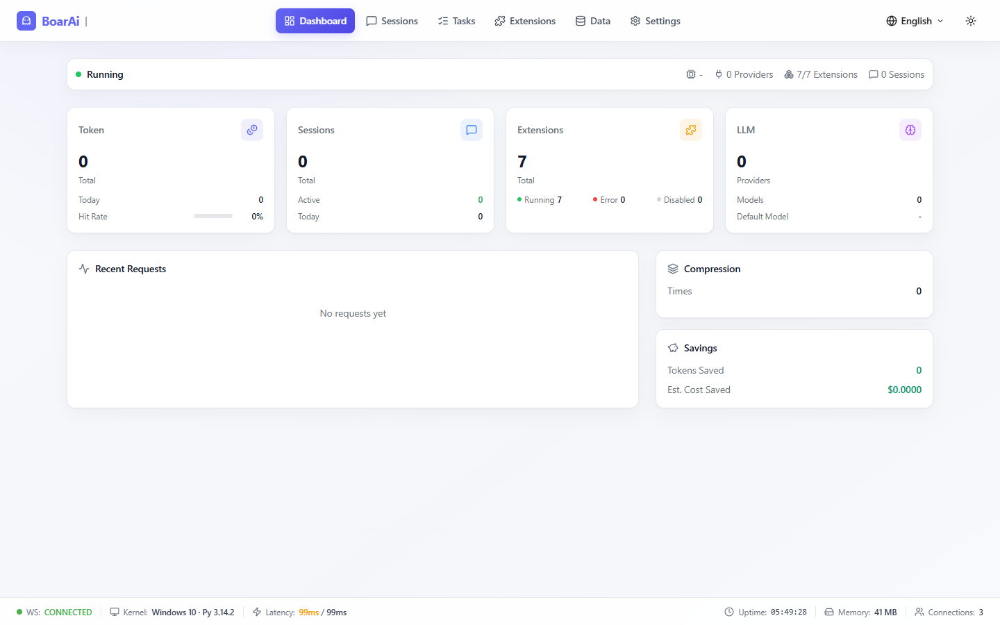
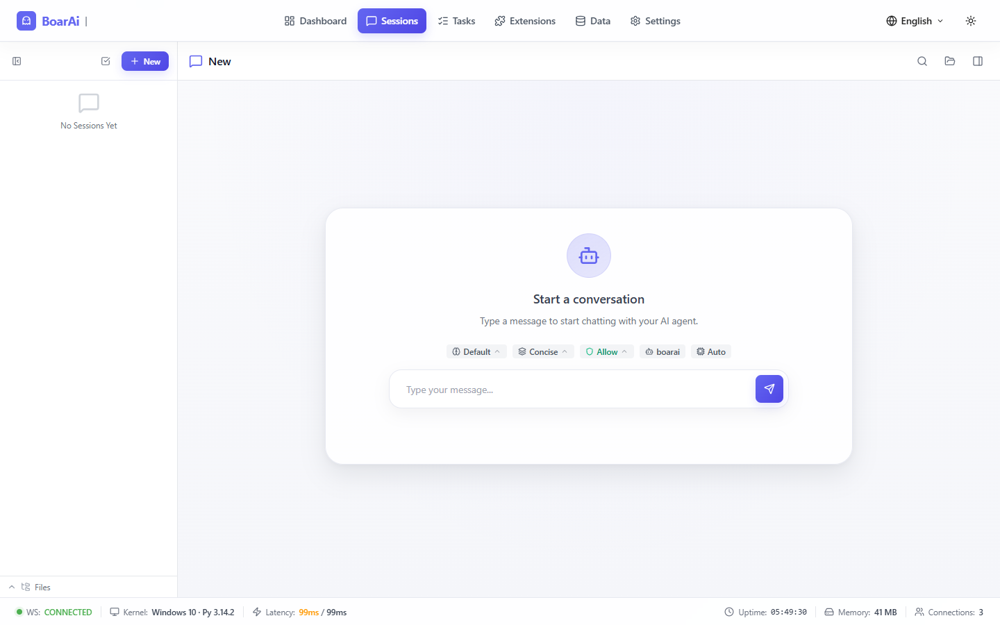
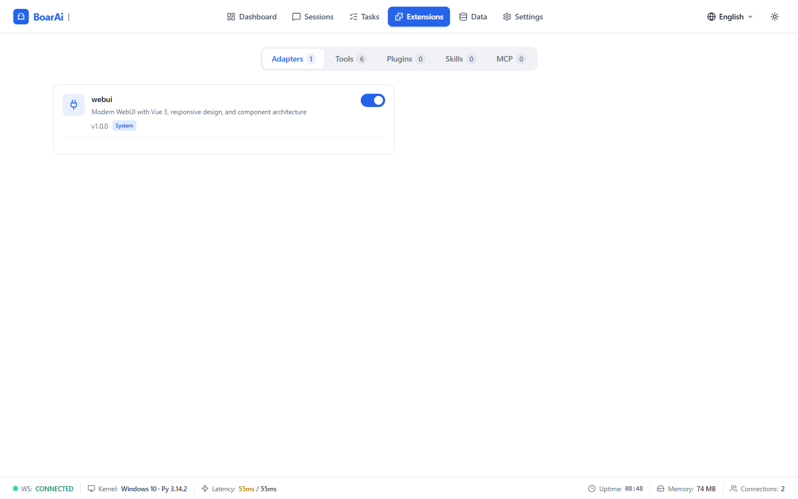
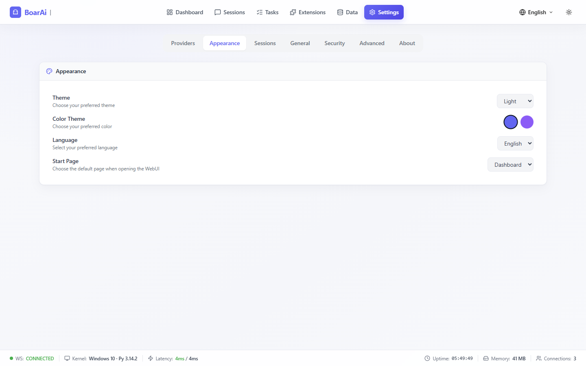

> **English** | [简体中文](README_zh.md)

# BoarAI

A minimal, hot-pluggable, cross-platform **microkernel AI agent framework** for Python 3.10+.





## What is BoarAI?

BoarAI splits an AI agent into a tiny kernel and hot-swappable extensions. The kernel (`boarai/core/`) provides only essential services — event bus, configuration, extension loading, session management, prompt assembly, LLM abstraction, tool registry, task system and security guards. Everything business-facing (file tools, shell, web access, memory tools, task tools, skill tools, the WebUI itself) ships as an extension that can be installed, removed, enabled, disabled or hot-reloaded at runtime without restarting the kernel.

## Features

- **Microkernel + extensions** — one-way dependency (core never imports extensions); extensions talk via the event bus or service calls; unloading one never breaks another.
- **Hot-pluggable** — routes, hooks, services, middleware and tools can be added/removed at runtime; external MCP tool servers are bridged from a manifest declaration.
- **Event-driven** — one async event bus with a centrally registered catalogue covering runs, tools, thinking, tasks, memory and extensions.
- **Multi-model LLM layer** — OpenAI-compatible and Anthropic providers on aiohttp, with streaming, reasoning modes, vision routing and failure fallback.
- **Sessions & run loop** — append-only journals, session tree with forks, batched tool execution, approval gating, file-change tracking with snapshot revert, context compression.
- **Self-improvement** — synaptic memory mesh, idle-time distillation, failure lessons, automatic SKILL.md creation and management.
- **Built-in WebUI** — Vue 3 single-port interface for chat, tasks, extensions, data browsing, file management and settings; English/Chinese.
- **Layered security** — access-key gate, path sandbox, tool permission guard, shell command classification, log/audit redaction, soft-delete recycle bin.
- **Cross-platform** — Linux / Docker / WSL / Windows; runtime data anchored at `~/.boarai/`, separate from the source tree.

## Requirements

- Python 3.10 or newer
- No database, no external services required

## Installation

### From PyPI

```bash
pip install boarai
```

### From source

```bash
cd <repo checkout>
pip install -r requirements.txt     # or: pip install -e .
```

If dependencies are missing on a fresh checkout, run `python main.py --ensure-deps` once.

### Docker

Three images mirror the three install/update channels — an install only ever updates through its own channel:

| Variant | Build & run | Needs the source tree? | In-container self-update |
|---------|-------------|------------------------|--------------------------|
| Source (default) | `docker compose up -d --build` | yes (`Dockerfile` copies it) | source channel (release-archive swap) |
| PyPI | `docker compose -f docker-compose.pypi.yml up -d --build` | no | pip channel (`pip install -U boarai`) |
| GitHub | `docker compose -f docker-compose.github.yml up -d --build` | no (clones the repo) | git channel (`git fetch --tags` + checkout) |

`docker-compose.pypi.yml` and `docker-compose.github.yml` are **self-contained**: the Dockerfile is inlined, so you can copy that single file to any machine (or paste it into a NAS compose UI) and build — nothing else is read from the build context. Requires Docker Compose >= 2.17. The source variant builds from the tree next to it; an unpacked PyPI sdist works as that tree.

PyPI-variant rebuilds are **incremental**: the base image and dependency layers stay cached, and a PyPI freshness probe busts only the boarai layer — a routine `up -d --build` reinstalls just the boarai wheel, never re-resolving or re-downloading dependencies.

Pin releases with `BOARAI_VERSION=0.1.1` (PyPI variant), `BOARAI_GIT_REF=v0.1.1` (GitHub variant), or `BOARAI_GIT_REPO=<your-fork>`; map a different host port with `BOARAI_HOST_PORT=8080`.

**Data persistence.** Inside the container everything lands under `BOARAI_DATA_DIR=/data`, bind-mounted to **`./.boarai` next to the compose file** — the folder you picked in the NAS UI when creating the project, named like a bare-metal `~/.boarai`. It survives `down`, `down -v`, image rebuilds and NAS reboots. Note: a dot-folder is hidden by default in some NAS file managers — enable "show hidden files". Set `BOARAI_DATA_HOST_DIR` to an absolute path to share one directory across variants or move it elsewhere.

Backup and restore are plain `tar`:

```bash
tar czf boarai-data.tgz -C ./.boarai .
tar xzf boarai-data.tgz -C ./.boarai
```

Upgrading from an older install that used the named volume `boarai-data`? Run this once from the compose directory **before** the first start:

```bash
docker run --rm -v boarai-data:/from -v "$PWD/.boarai":/to alpine sh -c "cp -a /from/. /to/"
```

**Upgrade order**: migrate first (the command above) or accept a fresh start → delete the old project in the NAS UI **without ticking "delete volumes"** (ticking it destroys the old data irrecoverably) → deploy the new yml; old and new share the container name `boarai`, so the old container must be gone first.

**First-run access key.** A bridged container never looks like a loopback peer, so claim the key whichever way suits you:

1. **Setup code (simplest).** The first-run log prints a one-shot code — open the WebUI from *any* machine and type it in. It is re-minted on every restart until the key is claimed; loopback peers need no code.

   ```bash
   docker compose logs boarai
   ```

2. **One-off command**, which prints the key once:

   ```bash
   docker compose run --rm boarai python main.py key init       # source / github images
   docker compose run --rm boarai python -m boarai key init     # pypi image
   ```

3. **Pre-seed** `BOARAI_API_TOKEN` (32+ base64url characters) in the compose file — adopted on first run only, never overrides an existing key.

## Quick start

### 1. Start the server

```bash
boarai                 # pip install: console script
python -m boarai       # pip install: module form
python main.py         # source checkout
```

The server listens on `http://localhost:26620` (HTTP + WebSocket on one port). Other subcommands: `stop`, `restart`, `status`, `key`.

### 2. Unlock the WebUI

Open `http://localhost:26620` in a browser. On first run the setup page asks you to **create an access key** — the key is shown once and only its hash is stored, so save it somewhere safe. Later devices unlock with that key; rotate it with `boarai key rotate` if it leaks.

### 3. Configure a model

Go to **Settings → LLM**, add a provider (OpenAI-compatible endpoint or Anthropic) with your API key and base URL, then pick a default model. Keys are stored only in `~/.boarai/config/llm.yaml` and never logged.

### 4. Chat

Open **Sessions**, press *New*, and type a message. The agent answers with streaming text, may call tools (file edits, shell, web fetch…) and asks for approval when a tool needs it. File changes of each run are tracked and can be reverted from the changes panel.

### 5. Explore

- **Tasks** — schedule periodic agent or script jobs.
- **Extensions** — enable/disable the shipped tools, browse failures, install user extensions from `~/.boarai/extensions/`.
- **Data** — browse memories, lessons and skills the agent accumulates.
- **Settings** — security policy, approval defaults, logging, update channel.





## Where things live

| What | Where |
|------|-------|
| Kernel | `boarai/core/` |
| Shipped extensions, prompts, defaults | `boar/` |
| Runtime data (config, sessions, logs, memory, trash) | `~/.boarai/` |
| User-installed extensions | `~/.boarai/extensions/` |

## Documentation

Each file covers exactly one kernel subsystem (English / 中文):

| | | |
|---|---|---|
| [Event system](docs/event.md) / [事件](docs/event_zh.md) | [Runtime](docs/runtime.md) / [运行时](docs/runtime_zh.md) | [Server](docs/server.md) / [服务器](docs/server_zh.md) |
| [API layer](docs/api.md) / [API](docs/api_zh.md) | [Config](docs/config.md) / [配置](docs/config_zh.md) | [Logging](docs/logging.md) / [日志](docs/logging_zh.md) |
| [Security](docs/security.md) / [安全](docs/security_zh.md) | [LLM layer](docs/llm.md) / [LLM](docs/llm_zh.md) | [Prompt](docs/prompt.md) / [提示词](docs/prompt_zh.md) |
| [Sessions & runs](docs/session.md) / [会话](docs/session_zh.md) | [Extensions](docs/extension.md) / [扩展](docs/extension_zh.md) | [Memory](docs/memory.md) / [记忆](docs/memory_zh.md) |
| [Tasks](docs/task.md) / [任务](docs/task_zh.md) | [Commands](docs/command.md) / [命令](docs/command_zh.md) | [Recycle bin](docs/trash.md) / [回收站](docs/trash_zh.md) |
| [Online update](docs/update.md) / [更新](docs/update_zh.md) | [Kernel fs](docs/fs.md) / [文件](docs/fs_zh.md) | [Shell backends](docs/shell.md) / [Shell](docs/shell_zh.md) |
| [Process](docs/process.md) / [进程](docs/process_zh.md) | [Dependencies](docs/dependency.md) / [依赖](docs/dependency_zh.md) | [Curation](docs/curator.md) / [整理](docs/curator_zh.md) |

Development rules (code placement, dependency boundaries, event/dual-channel registration chains, coding style, testing) live in [`CODE_STANDARDS.md`](CODE_STANDARDS.md) ([中文](CODE_STANDARDS_zh.md)) at the repository root.

## License

MIT — see [LICENSE](LICENSE).
