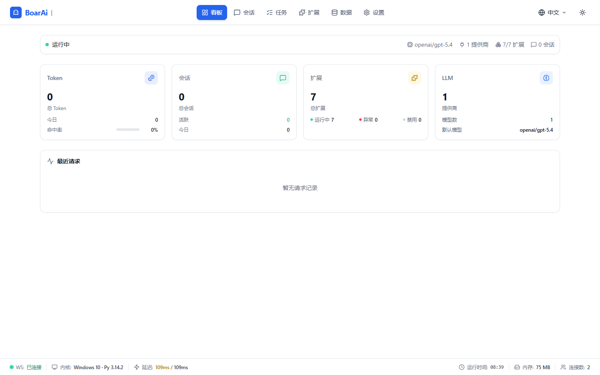
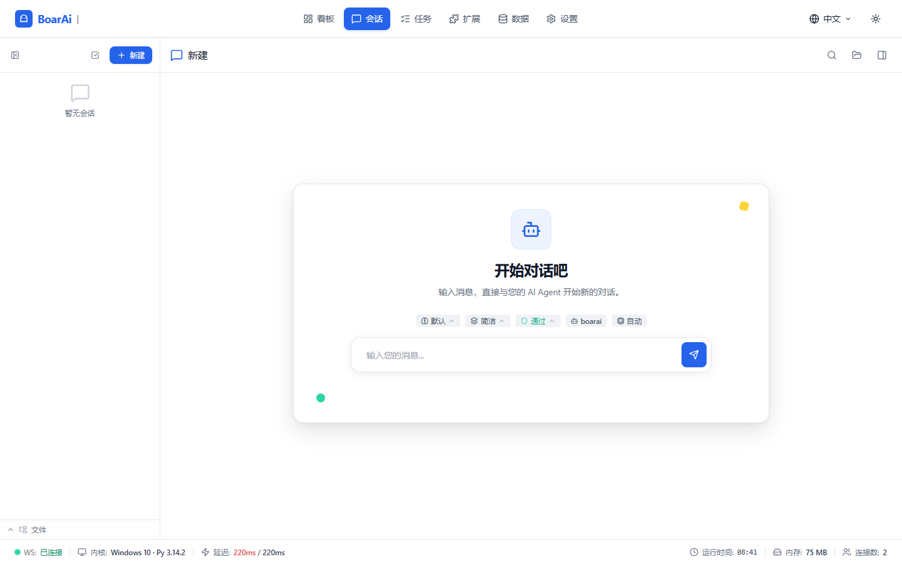
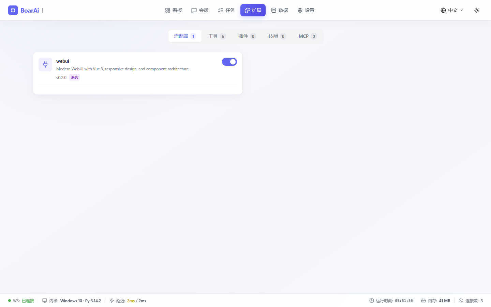
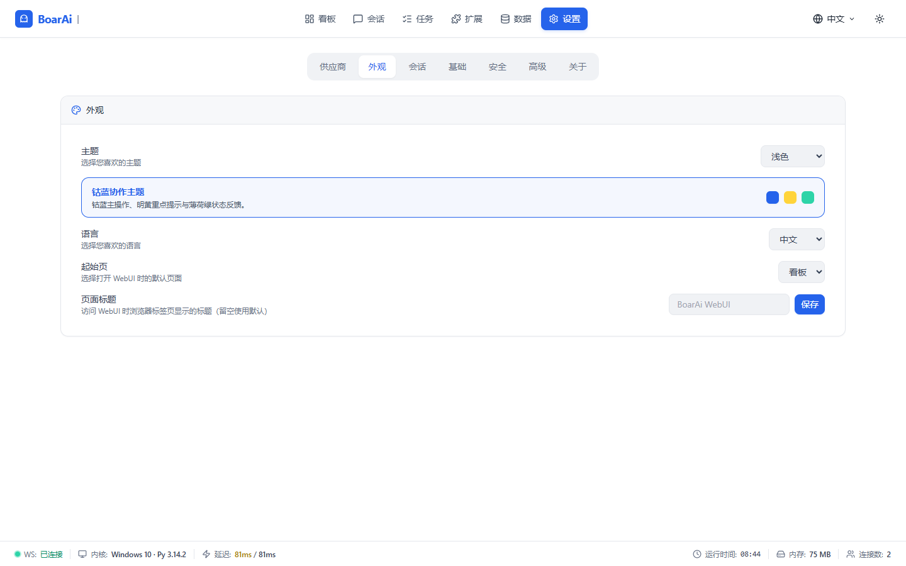

> [English](README.md) | **简体中文**

# BoarAI

基于 Python 3.10+ 的极简、热插拔、跨平台**微内核 AI Agent 框架**。





## BoarAI 是什么？

BoarAI 把 AI Agent 拆成极小的内核与可热插拔的扩展。内核（`boarai/core/`）只提供基础服务——事件总线、配置、扩展加载、会话管理、提示词组装、LLM 抽象、工具注册、任务系统与安全守卫；一切面向业务的能力（文件工具、shell、网页访问、记忆工具、任务工具、技能工具、WebUI 本身）都以扩展形式交付，可在运行期安装、卸载、启停、热重载，无需重启内核。

## 核心特性

- **微内核 + 扩展**——单向依赖（core 永不 import 扩展）；扩展间经事件总线或服务调用通信；卸载任一扩展不影响其他扩展。
- **热插拔**——路由、钩子、服务、中间件、工具运行时热增删；外部 MCP 工具服务器经 manifest 声明自动桥接。
- **事件驱动**——统一异步事件总线，事件目录集中登记，覆盖运行、工具、思考、任务、记忆与扩展。
- **多模型 LLM 层**——基于 aiohttp 的 OpenAI-compatible 与 Anthropic 供应商，支持流式、思考模式、视觉路由与失败回退。
- **会话与运行循环**——追加式日志、可派生的会话树、工具批量执行、审批门控、文件变更追踪与快照回滚、上下文压缩。
- **自我改进**——突触记忆网格、闲置蒸馏、失败教训、SKILL.md 技能自动生成与管理。
- **内建 WebUI**——Vue 3 单端口界面：聊天、任务、扩展、数据浏览、文件管理、设置；中英双语。
- **分层安全**——访问钥匙门禁、路径沙箱、工具权限守卫、shell 命令分类、日志/审计脱敏、软删除回收站。
- **跨平台**——Linux / Docker / WSL / Windows；运行时数据锚定 `~/.boarai/`，与源码树分离。

## 环境要求

- Python 3.10 及以上
- 无需数据库与外部服务

## 安装

### PyPI 安装

```bash
pip install boarai
```

### 源码运行

```bash
cd <仓库检出目录>
pip install -r requirements.txt     # 或：pip install -e .
```

全新检出若缺依赖，执行一次 `python main.py --ensure-deps`。

### Docker

三个镜像对应三种安装/更新渠道——安装只经自己的渠道自更新：

| 变体 | 构建并运行 | 需要源码树？ | 容器内自更新 |
|------|-----------|--------------|--------------|
| 源码（默认） | `docker compose up -d --build` | 需要（`Dockerfile` 要 COPY） | source 渠道（发行包归档替换） |
| PyPI | `docker compose -f docker-compose.pypi.yml up -d --build` | 不需要 | pip 渠道（`pip install -U boarai`） |
| GitHub | `docker compose -f docker-compose.github.yml up -d --build` | 不需要（镜像内 clone） | git 渠道（`git fetch --tags` + checkout） |

`docker-compose.pypi.yml` 与 `docker-compose.github.yml` 是**自带全部内容的单文件**：Dockerfile 已内联，把这一个文件拷到任何机器（或直接粘进 NAS 的 compose 界面）就能构建，构建上下文里不需要任何东西。要求 Docker Compose >= 2.17。源码变体则必须在其旁边的源码树里构建——解包 PyPI 的 sdist 即可当作那棵树。

锁定版本：`BOARAI_VERSION=0.1.1`（PyPI 变体）、`BOARAI_GIT_REF=v0.1.1`（GitHub 变体）、`BOARAI_GIT_REPO=<你的 fork>`；换宿主端口用 `BOARAI_HOST_PORT=8080`。

**数据持久化**：会话、记忆、日志、配置与用户扩展全部落在 `BOARAI_DATA_DIR=/data`，由命名卷 `boarai-data` 承载（三个变体共用同一个卷，换渠道不丢数据）。`docker compose down` 保留数据，`docker compose down -v` 会删除。备份与恢复：

```bash
docker run --rm -v boarai-data:/data -v "$PWD":/backup alpine tar czf /backup/boarai-data.tgz -C /data .
docker run --rm -v boarai-data:/data -v "$PWD":/backup alpine tar xzf /backup/boarai-data.tgz -C /data
```

想直接用宿主目录（NAS 常见做法），把 `- boarai-data:/data` 换成 `- /volume1/docker/boarai:/data`，并先把目录属主改成运行时用户——容器**不是 root**，跑在 uid/gid `10001`（可用 `BOARAI_UID` / `BOARAI_GID` 覆盖）：

```bash
mkdir -p /volume1/docker/boarai && chown -R 10001:10001 /volume1/docker/boarai
```

**首次访问钥匙**：桥接网络下的容器永远不像回环来源，因此认领钥匙有三种方式，任选其一：

1. **setup code（最省事）**：首次启动的日志会打印一个一次性验证码，在**任何**机器上打开 WebUI 输进去即可。钥匙认领前每次重启都会重新生成；回环来源不需要验证码。

   ```bash
   docker compose logs boarai
   ```

2. **一次性命令**，会打印出钥匙：

   ```bash
   docker compose run --rm boarai python main.py key init       # 源码 / github 镜像
   docker compose run --rm boarai python -m boarai key init     # pypi 镜像
   ```

3. **预置** `BOARAI_API_TOKEN`（≥32 位 base64url 字符）到 compose 文件里——只在首次启动时被采纳，绝不覆盖已有钥匙。

## 快速上手

### 1. 启动服务器

```bash
boarai                 # pip 安装：控制台脚本
python -m boarai       # pip 安装：模块形式
python main.py         # 源码检出
```

服务器监听 `http://localhost:26620`（HTTP 与 WebSocket 同端口）。其余子命令：`stop`、`restart`、`status`、`key`。

### 2. 解锁 WebUI

浏览器打开 `http://localhost:26620`。首次运行由引导页**创建访问钥匙**——钥匙只显示一次、服务器只存哈希，请妥善保存；其他设备用这把钥匙解锁；泄露时用 `boarai key rotate` 轮换。

### 3. 配置模型

进入 **设置 → LLM**，添加供应商（OpenAI-compatible 端点或 Anthropic）的密钥与 Base URL，选择默认模型。密钥只存 `~/.boarai/config/llm.yaml`，永不入日志。

### 4. 开始对话

打开 **会话**，点 *新建*，输入消息。Agent 以流式文本回复，可能调用工具（文件编辑、shell、网页抓取……），需要授权时会先征求批准；每次运行的文件变更都被追踪，可在变更面板一键回滚。

### 5. 继续探索

- **任务**——编排周期性 agent / 脚本任务。
- **扩展**——启停内置工具、查看加载失败、从 `~/.boarai/extensions/` 安装用户扩展。
- **数据**——浏览 Agent 积累的记忆、教训与技能。
- **设置**——安全策略、审批默认、日志、更新渠道。





## 数据落在哪

| 内容 | 位置 |
|------|------|
| 内核 | `boarai/core/` |
| 随包扩展 / 提示词 / 首启种子 | `boar/` |
| 运行时数据（配置、会话、日志、记忆、回收站） | `~/.boarai/` |
| 用户安装扩展 | `~/.boarai/extensions/` |

## 文档

每个文件只介绍一个内核子系统（English / 中文）：

| | | |
|---|---|---|
| [事件系统](docs/event_zh.md) / [Event](docs/event.md) | [运行时](docs/runtime_zh.md) / [Runtime](docs/runtime.md) | [服务器](docs/server_zh.md) / [Server](docs/server.md) |
| [API 层](docs/api_zh.md) / [API](docs/api.md) | [配置](docs/config_zh.md) / [Config](docs/config.md) | [日志](docs/logging_zh.md) / [Logging](docs/logging.md) |
| [安全](docs/security_zh.md) / [Security](docs/security.md) | [LLM 层](docs/llm_zh.md) / [LLM](docs/llm.md) | [提示词](docs/prompt_zh.md) / [Prompt](docs/prompt.md) |
| [会话与运行](docs/session_zh.md) / [Session](docs/session.md) | [扩展](docs/extension_zh.md) / [Extension](docs/extension.md) | [记忆](docs/memory_zh.md) / [Memory](docs/memory.md) |
| [任务](docs/task_zh.md) / [Task](docs/task.md) | [命令](docs/command_zh.md) / [Command](docs/command.md) | [回收站](docs/trash_zh.md) / [Trash](docs/trash.md) |
| [在线更新](docs/update_zh.md) / [Update](docs/update.md) | [内核文件](docs/fs_zh.md) / [FS](docs/fs.md) | [Shell 后端](docs/shell_zh.md) / [Shell](docs/shell.md) |
| [进程](docs/process_zh.md) / [Process](docs/process.md) | [依赖](docs/dependency_zh.md) / [Dependency](docs/dependency.md) | [后台整理](docs/curator_zh.md) / [Curator](docs/curator.md) |

开发规范（代码放置、依赖边界、事件/双通道登记链、编码风格、测试约定）见仓库根 [`CODE_STANDARDS_zh.md`](CODE_STANDARDS_zh.md)（[English](CODE_STANDARDS.md)）。

## 许可证

MIT — 见 [LICENSE](LICENSE)。
